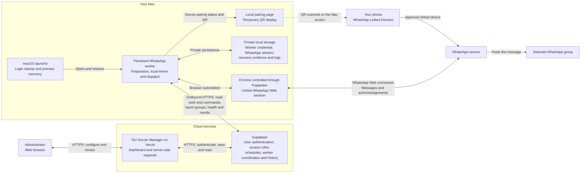

# WhatsApp message scheduler: architecture and message flow

## Overview

The WhatsApp scheduler connects three parts of OU Soccer Manager: the **web admin dashboard**, the **Supabase backend**, and a **background worker running on your Mac**. An administrator saves a message and its schedule in the dashboard. Supabase stores that configuration. The Mac worker reads it, prepares the message, and sends it through your personal account's linked WhatsApp Web session when the scheduled time arrives.

For example, a weekly signup announcement can be scheduled for **Monday at 9:00 PM in America/Toronto**. The worker resolves the upcoming Sunday date, checks that the destination and connection are valid, and requests final authorization before sending. It then reports the result and timing information to Supabase so administrators can review it in the dashboard.

The dashboard does not need to stay open. The Mac must remain powered on, logged in, awake, and connected to the internet. Vercel hosts the website; the Mac performs the actual WhatsApp sending.

For installation and operating commands, see the separate [step-by-step setup guide](whatsapp-scheduler.md). This document explains the design and responsibilities rather than setup commands or code internals.

## Architecture diagram

The QR-scanning arrow represents scanning the Mac's screen with the phone, not opening the local pairing URL on the phone. The local pairing page is available only on the Mac. Its QR material is not relayed through Supabase or the hosted dashboard.

The cloud does not make an incoming connection to your Mac. The worker initiates connections to Supabase and WhatsApp. Administrator requests such as reconnecting are stored in Supabase and picked up by the worker.

## Technical components and technology stack

| Component | Technology | Responsibility |
|---|---|---|
| Web dashboard | Next.js 15 App Router, React 19, TypeScript | Provides Schedules, Templates, and Connections & History views; processes administrator requests through the existing app |
| Dashboard presentation | Tailwind CSS 3, Lucide, Sonner | Uses the application's existing styling, icons, and notifications |
| Application backend | Supabase APIs and PostgreSQL | Stores messaging configuration and history; coordinates workers and authorizes execution |
| User access control | Supabase Auth and PostgreSQL row-level security | Identifies dashboard users and restricts messaging management to authorized organization administrators |
| Local sender | Node.js and TypeScript | Runs independently of the website, prepares messages, maintains local timers, and tracks outcomes |
| WhatsApp integration | whatsapp-web.js, Puppeteer, Google Chrome | Automates a linked WhatsApp Web session for group discovery, sending, and acknowledgement tracking |
| Local pairing | Local HTTP page and QR rendering | Displays a temporary, protected QR code on the Mac for phone-based linking |
| Scheduling and validation | Temporal timezone support and Zod | Calculates local-calendar execution times and validates configuration and placeholders |
| Background service | macOS launchd | Starts the worker after login and restarts it after unexpected process exits |
| Shared project structure | pnpm workspaces | Keeps the web app, worker, and reusable communications logic in the existing monorepo |
| Automated verification | Vitest, mocked WhatsApp clients, and database tests | Checks scheduling, authorization, duplicate prevention, and recovery without sending real messages |

The WhatsApp integration uses the personal account's Web session. It does not use the official WhatsApp Business Cloud API. Because it is unofficial, account restrictions and upstream WhatsApp Web changes remain operational risks.

The initial administration interface is the web dashboard. Shared communications logic can support later Management mobile features, but the mobile apps currently do not provide these scheduler screens.

## How the components communicate

### Administrator → website → Supabase

The administrator signs in through the existing application and selects an organization. The dashboard sends configuration requests through the website's server-side functionality. The app verifies administrator authority, and Supabase applies organization-level database access rules.

Templates, message text, selected destinations, recurrence settings, and enable/disable choices are saved in Supabase. Viewing history follows the reverse path: the website reads records from Supabase and displays them in the browser.

Saving a schedule does not itself send a WhatsApp message.

### Mac worker ↔ Supabase

The worker connects directly to Supabase over HTTPS using a provisioned, organization-scoped worker credential. It does not depend on the Vercel website forwarding each scheduled execution to it.

The worker uses one combined synchronization every thirty seconds while active (ninety-second lease), or hourly while idle (65-minute lease), to retrieve controls, expire old work, and detect changes. It caches schedules and wakes locally thirty minutes before an enabled occurrence when automation is on, remaining active through a five-minute cooldown. Startup gives a thirty-minute maintenance window. Idle mode closes Chrome without logging out and stops browser reconnection/group discovery. Website changes require the next synchronization or a manual Mac worker restart for earlier pickup. Unchanged schedules and work are omitted from the response and reused from the local cache. In the other direction, it reports discovered WhatsApp groups, periodic heartbeats, connection state, execution results, and timing information. Restricted database operations check the worker credential and coordinate which worker is allowed to act.

This communication uses polling rather than Supabase Realtime. The dashboard checks lightweight status approximately every thirty seconds while visible and pauses polling in hidden tabs; full configuration and history summaries are loaded when needed. A change can take up to about thirty seconds to reach the worker or appear in the dashboard. There is no requirement to keep an administrator's browser tab open for scheduled sending.

### Mac worker ↔ Chrome ↔ WhatsApp

The worker controls a separate Chrome session through Puppeteer and whatsapp-web.js. WhatsApp Web connects that browser to the WhatsApp service using the account linked from your phone.

At startup/reconnection, every fifteen minutes, or on an administrator request, the browser discovers groups available to the account and sends to the specific group chosen in a schedule. WhatsApp acknowledgements return through the same integration, and the worker records what it observes. The connected account must belong to the destination group and have permission to post there.

### Dashboard control request → worker action

Actions such as reconnecting or disconnecting are requested through the dashboard and stored in Supabase. The Mac worker retrieves and performs them. An offline Mac cannot immediately carry out a browser logout or reconnection request, even though the dashboard can still save configuration changes.

A confirmed test message is also recorded as work for the worker to pick up. It requires a ready connection and a selected group. Test sending is independent of the automatic-send switch, so a deliberately confirmed test can be sent while automatic schedules remain off.

## What happens during a scheduled message

1. **Configure.** An administrator creates a schedule, selects a discovered WhatsApp group, and saves either custom text or text copied from a reusable template. The schedule specifies its local time, timezone, and one-time or recurring pattern.
2. **Calculate.** Shared scheduling logic determines upcoming execution times. The worker batches new or changed planned executions into Supabase for a rolling twenty-four-hour horizon, and caches them locally. It does not ask Supabase every second whether a message is due.
3. **Prepare.** Before the execution time, the worker prepares the message and checks connectivity. Dynamic values such as the next Sunday date are resolved using the scheduled local date; venue and match time come from the schedule's fields.
4. **Wait locally.** The persistent worker uses local timers to approach the target time. A weekly Toronto schedule follows Toronto wall time through daylight saving changes.
5. **Authorize.** Immediately before dispatch, Supabase checks the current schedule, destination, worker ownership, and automatic-send settings. It grants a single execution attempt. If the authorization cannot be obtained, the worker does not proceed with sending.
6. **Dispatch and observe.** The worker records dispatch intent locally and invokes the WhatsApp send operation through Chrome. It records the actual invocation time and watches for a WhatsApp server acknowledgement.
7. **Report and review.** New or changed results and timestamps are written back to Supabase. Unchanged unknown outcomes are not repeatedly rewritten, and failed reporting uses bounded backoff while preserving local evidence. The dashboard displays the scheduled time, dispatch time, observed acknowledgement time, status, latency, and any recorded issue.

Two switches control automatic posting: the **individual schedule must be enabled**, and the organization's worker connection must have **automatic sending activated**. Both start disabled for the initial setup.

Templates and schedules are separate saved items. Applying a template copies its text into a schedule; editing the template later does not silently alter previously saved schedules.

### Example: Monday signup announcement

| Stage | What happens |
|---|---|
| Schedule | Monday, 9:00 PM, America/Toronto, with the actual OU Soccer group selected |
| Before sending | The worker prepares the announcement and replaces the next-Sunday placeholder |
| At the target time | The worker obtains final authorization and invokes WhatsApp sending as close to the target as practical |
| After sending | The worker reports the outcome and measured dispatch latency; the administrator reviews history |

The dashboard's upcoming dates describe the schedule. They do not prove that the Mac is currently available; connection state and heartbeat must also be checked.

## Where information is stored

| Information | Stored in Supabase | Stored privately on the Mac |
|---|---|---|
| Templates and schedule configuration | Yes | Loaded by the worker while processing |
| Discovered group identifiers and names | Yes | Available through the connected WhatsApp session |
| Prepared message text and execution history | Yes | Used during execution |
| Worker health and connection status | Yes | Observed by the running worker |
| Administrator control requests | Yes | Retrieved for processing |
| Worker authentication credential | A hash used for verification | The provisioned credential in private configuration |
| WhatsApp linked-device session | No | Yes, persisted across normal restarts |
| QR pairing material | No | Held and displayed locally for pairing |
| Recovery evidence and operational logs | Reported results are stored centrally | Local evidence is retained for crash/outage recovery |

Supabase therefore holds message content and group metadata as well as schedules. Keeping WhatsApp credentials local does not mean all messaging information stays on the Mac.

## Authentication and environment boundaries

There are three distinct identities:

- **Dashboard user:** your application login, authenticated by Supabase and authorized for an organization.
- **Mac worker:** a provisioned worker ID and credential tied to the organization in a particular Supabase project.
- **WhatsApp account:** your personal account, linked to the Mac's browser by QR confirmation on the phone.

Linking WhatsApp does not create a schedule or authorize automatic posting. Provisioning a worker does not authenticate the WhatsApp account. Each connection has its own purpose.

Development and production remain separate when they use separate Supabase projects. Each project has its own worker provisioning, schedules, templates, destination records, and history. The website and Mac worker must target the same intended project.

The current single-worker configuration targets one Supabase project at a time. Switching that configuration to production changes where it reads work and reports results; it does not transfer development schedules. The local WhatsApp session can normally be reused on the same Mac, provided it is still valid.

## Reliability and practical limits

| Situation | Expected behavior |
|---|---|
| Administrator closes the dashboard | The local worker continues running and checking schedules |
| Mac sleeps, shuts down, or loses connectivity | The worker cannot reliably execute the scheduled send |
| Execution is more than five seconds late before dispatch | It is marked missed rather than sent as a catch-up message |
| Supabase is unavailable for final authorization | Sending is withheld; the worker does not rely on an old authorization to start a new attempt |
| Multiple workers try to act | Database ownership and execution claiming, together with a local process lock, reduce competing or duplicate attempts |
| Worker crashes around sending | Durable local evidence supports recovery; uncertain delivery is treated as unknown and is not automatically retried |
| WhatsApp connection is interrupted | The worker attempts reconnection where possible; authentication failure may require renewed QR pairing |
| Service process exits unexpectedly | launchd can restart it, but cannot make an asleep, logged-out, or offline Mac available |
| An administrator disables messaging after a send has started | The in-progress message cannot be recalled by that setting change |

**Sent** means the worker observed a WhatsApp server acknowledgement. It does not mean every group member received or read the message. **Unknown** means delivery could not be established safely; the group should be checked before choosing a manual resend.

The main timing measurement is **dispatch latency**: how far the actual send invocation was from its scheduled time. Network delays, browser activity, operating-system scheduling, and WhatsApp processing can affect the eventual delivery time. Millisecond-accurate delivery and exactly-once delivery cannot be guaranteed.

## Related documentation

- [Step-by-step Mac, Supabase, Vercel, and WhatsApp setup](whatsapp-scheduler.md)
- [Project architecture and operational context](project-memory.md)
